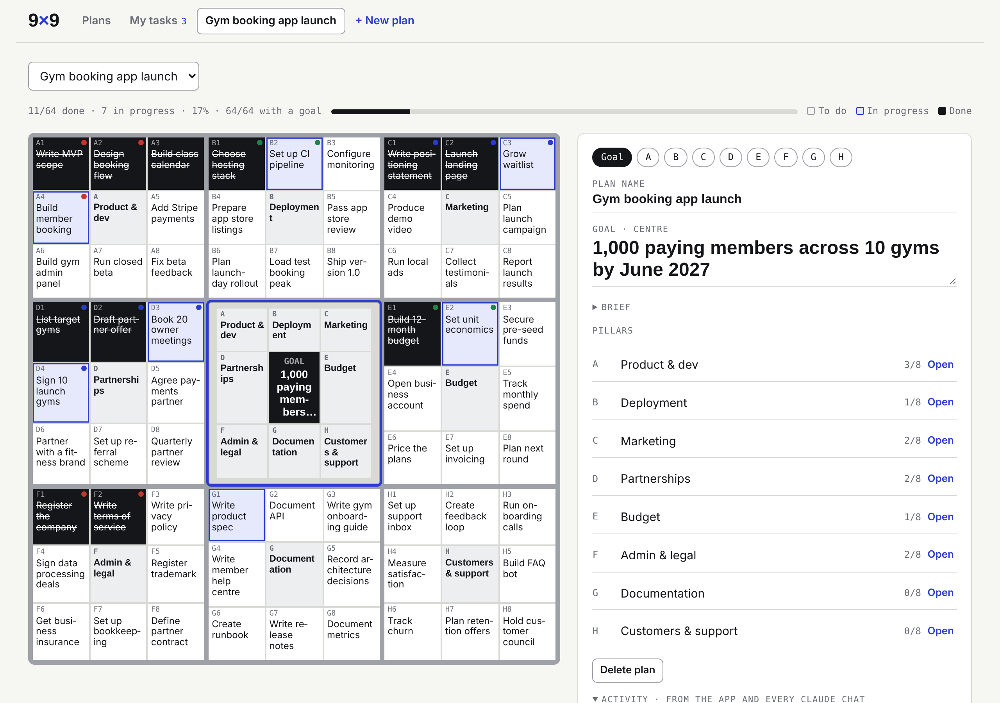
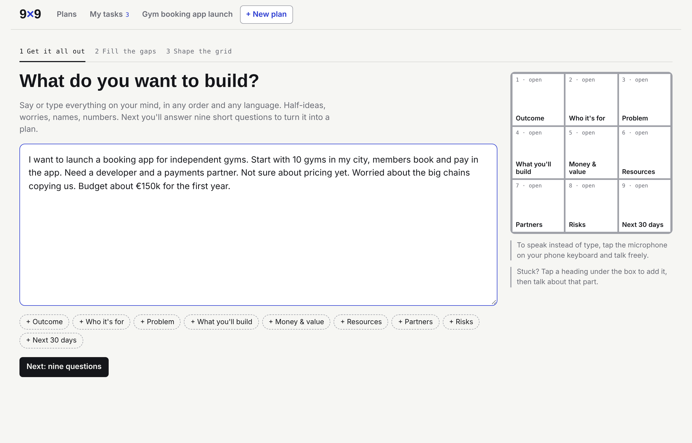
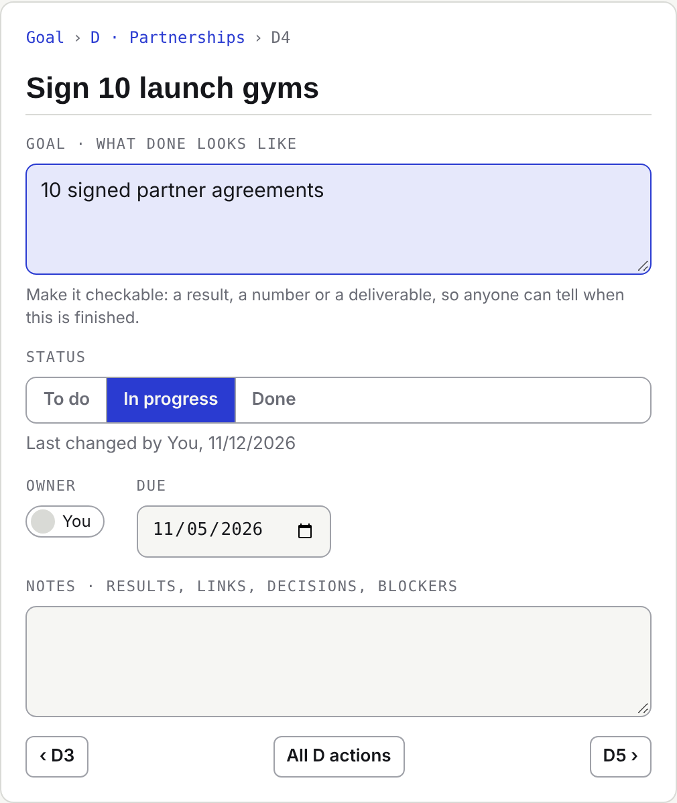
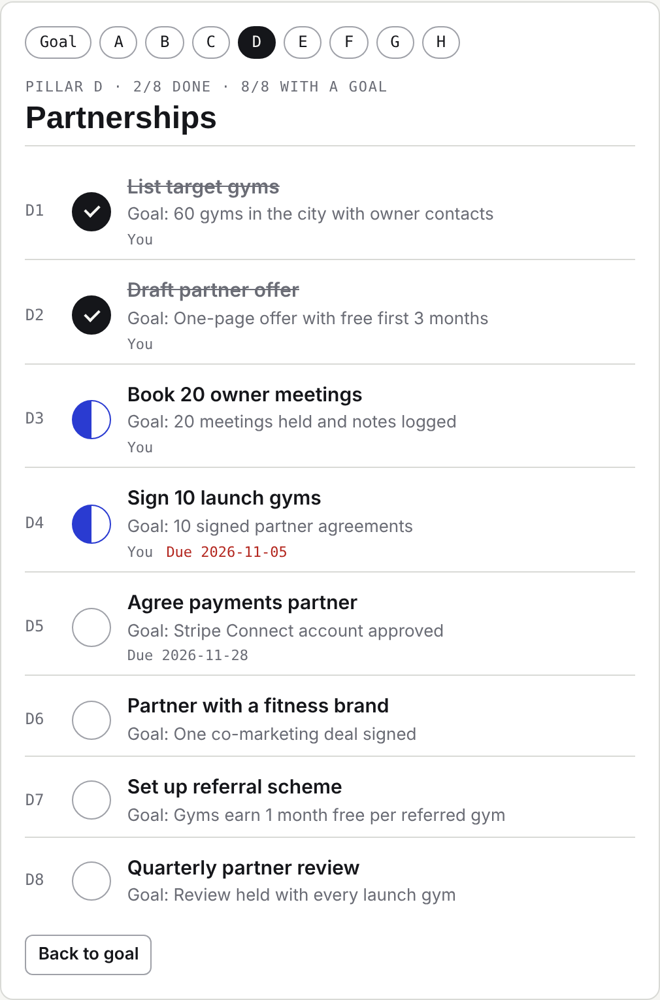
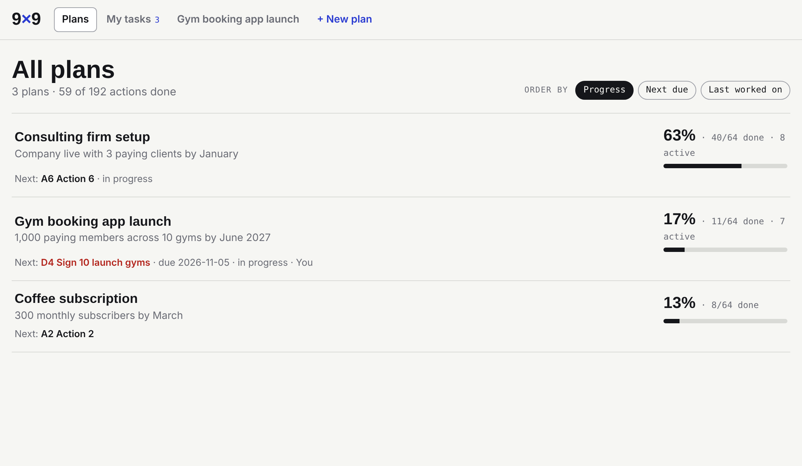
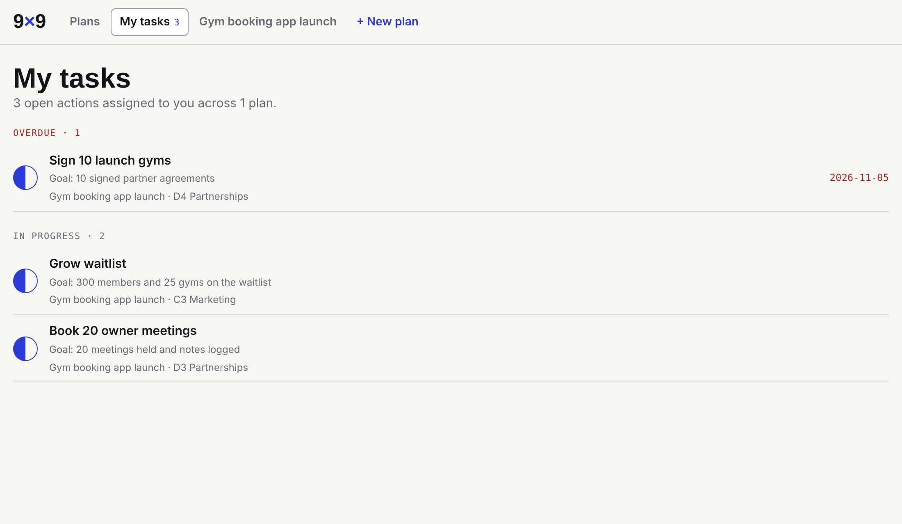
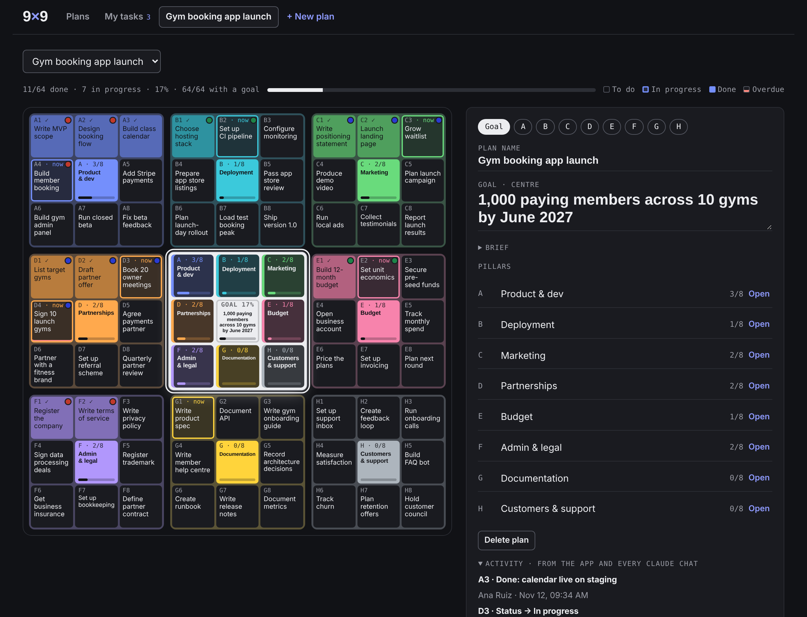
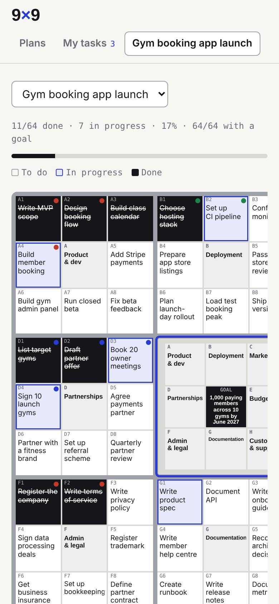

# 9×9 Planner for Claude

**Turn any project into one visual plan of action, and work through it with Claude from any chat.** Built on the 9×9 chart of the Harada Method, the goal-setting system behind top performers like Shohei Ohtani.

One goal in the centre. Eight pillars around it that must all succeed. Eight actions under each pillar, every one with a clear definition of done. That's 64 actions covering everything from the code to the marketing, the budget, the paperwork and the documentation, on one grid you can see at a glance.



**[Download the skill (ZIP)](https://github.com/MK-Lib/9x9-planner/raw/main/9x9-planner.zip)** · [Install](#install) · [Commands](#commands) · [How it works](#how-it-works)

---

## The problem it solves

Building something with Claude is fast, but the project ends up scattered. Ideas sit in one chat, decisions in another, a half-finished spec in a third. Every new chat starts from zero, so you explain the project again and still lose track of what was done and what was only talked about.

Development also tends to swallow all the attention. The app gets built, but nobody has priced it, registered the company, lined up a payments partner, written the privacy policy, planned the launch or documented how any of it works. Those gaps usually show up only at the end, when they are most expensive to fix.

The 9×9 Planner gives the project one home and one shape. It turns what's in your head, or in a long chat, into a complete checklist across every area of the project, keeps it updated as you and Claude work, and lets you pick up any part of it at any moment from any chat.

## Where the 9×9 comes from

The 9×9 grid, also known as the Mandala chart or the "open window 64" chart, is the planning tool at the heart of the **Harada Method**, a Japanese approach to achieving ambitious goals.

**Takashi Harada** created it as a track-and-field coach at a school in Osaka. His team started out among the weakest in the city. Harada studied how the world's best coaches and achievers worked, and turned what he learned into a method his students used every day: one clear goal, the qualities and actions needed to reach it, and a daily habit of tracking progress. His students went on to win national titles again and again. The method was later adopted by Japanese companies to develop their people, and it reached the West through the book *The Harada Method*, which Harada co-wrote with management author Norman Bodek.

Its most famous user is **Shohei Ohtani**. As a high-school pitcher, coached by a teacher trained in Harada's approach, he filled in a 9×9 chart. In the centre he wrote his goal: to be the first-round draft pick of eight professional teams. Around it he placed the areas that had to come together, including body conditioning, control, pitch speed, mental toughness, character and even luck, each broken into eight concrete actions. He reached that goal and went on to become one of the most celebrated players in modern baseball. The chart is now used by athletes, founders and executives to turn a big ambition into daily work.

The structure is simple and hard to cheat:

- **The centre** is one goal you can measure: a number and a date.
- **Eight pillars** surround it. They are the areas that must *all* succeed for the goal to happen. For a product launch these are usually things like product, deployment, marketing, partnerships, budget, admin and legal, documentation, and customers.
- **Eight actions** sit under each pillar, ordered so the first one can start this week.

Because every pillar gets the same eight slots, the grid makes it obvious when an area has been neglected. Empty squares are the questions you haven't answered yet. This skill keeps that discipline and adds what the paper chart can't: Claude to help fill it in, a live view of progress, and a plan you can pick up from any chat.

## What it does

- **Organises your thinking.** Talk or type everything about your idea in any order. Claude sorts it into a brief, shows what's clear, vague or missing, and asks sharp follow-up questions about *your* idea.
- **Builds the complete plan.** It proposes a measurable goal, 8 pillars and 64 actions, each with a goal you can check ("10 signed partner agreements", not "work on partners").
- **Captures a chat you've already had.** Mid-project? `/9x9-planner capture` reads the conversation, marks what's already done, lists what was discussed but not done, and fills in the areas the chat never touched.
- **Shows progress visually.** A live grid in Claude: dark squares are done, outlined ones are in progress. There's also a list of all your plans ranked by progress, and a "My tasks" view per person.
- **Works with you on any action.** Say `/9x9-planner work` and Claude takes the next action, checks its goal, does the research, drafts or analysis, and ticks it off when the goal is met.
- **Stays in sync everywhere.** Every chat reads and writes the same live plan, and every change goes into a shared activity log. Nothing lives in a single chat.
- **Keeps the whole plan consistent.** When something changes, such as a slipped date, a new decision or a finished result, Claude checks which other actions are affected and proposes the follow-on edits.
- **Supports teams.** Invite people to your planner, assign an owner to each action, and see who changed what.

## Use it for

Product and app launches · starting a company · fundraising rounds · opening a shop or venue · events and conferences · research projects · client delivery · career moves · anything with more moving parts than you can hold in your head.

## Install

**Claude (web, desktop, mobile)**

1. Download **[9x9-planner.zip](https://github.com/MK-Lib/9x9-planner/raw/main/9x9-planner.zip)**.
2. In Claude, open **Customize → Skills**, click **+**, then **Create skill → Upload a skill**, and choose the ZIP.
3. Make sure the skill is switched on. Code execution and file creation must be enabled in your settings.
4. Start a chat and type `/9x9-planner`.

The first time you use it, Claude offers to install your own private planner (a claude.ai artifact) and remembers its link for every future chat.

**Claude Code**

Copy the `9x9-planner` folder into `~/.claude/skills/`, or into `.claude/skills/` inside a project. Outside claude.ai, the skill keeps the plan as a Markdown plan file instead of the live planner.

## Commands

You can type a command after `/9x9-planner`, or just say what you want ("what's next on my launch plan?").

| Command | What it does |
|---|---|
| `new` | Brain dump → brief with follow-up questions → goal and 8 pillars → 64 actions with goals → saved |
| `capture` | Builds the plan from the current chat, marking what's already done |
| `import` | Turns a pasted plan, table, doc or notes into a 9×9 |
| `open <name>` | Loads a plan as this chat's plan of action, with status and the next 3 actions |
| `work [code]` | Works the next action (or e.g. `C4`) with you until its goal is met, then ticks it off |
| `update <changes>` | "B3 done", "C1 blocked on legal", "give D to Anna, due Friday" |
| `list` | All plans with progress, overdue items and next actions |
| `review` | Weekly-style report: what moved, what's stuck, what matters next, decisions to make |
| `snapshot` | A dated, read-only Markdown export to share outside Claude |

## How it works

**The live planner** is a small app published as a private claude.ai artifact in *your* account, with its own database. The skill installs it for you from `assets/planner.html` on first use. Inside it you get:

- a **guided start** for new plans;
- the **9×9 grid**, where every action is clickable and has a goal, status, owner, due date and notes;
- a **Plans** list ranked by progress, next due date or last activity;
- **My tasks**, with each person's open actions across all plans;
- an **activity log** of every change from the app and from every Claude chat;
- **Claude drafting** to fill empty actions and write sharper goals.

Claude reads and writes that same database from any chat through the skill, so the plan you see and the plan Claude works on are always the same plan.

**Without the live planner**, for example in Claude Code or where artifacts aren't available, the skill keeps the plan as a Markdown file with one table per pillar and a log. The commands and rules are the same.

**Your data stays in your account.** Plans live in your own artifact, which is private until you share it. If you share it, everyone with access can see every plan in that planner, so use separate planners for separate audiences.

## Screenshots

| Guided start | An action and its goal |
|---|---|
|  |  |

| A pillar's actions | All plans |
|---|---|
|  |  |

| My tasks | Dark mode | Phone |
|---|---|---|
|  |  |  |

*Screenshots show a fictional example project.*

## FAQ

**Does it cost anything?** The skill is free. Claude features inside the planner run on the account of whoever uses them, within their normal Claude plan.

**Can my team use it?** Yes. Invite them from the planner's Share menu with access that lets them edit. Each person shows up in the owner list once they've opened the planner.

**Which languages does it work in?** Any. Plans stay in the language you write them in.

**Can I keep several projects?** Yes. One planner holds any number of plans, and `/9x9-planner list` shows them all.

## Repository layout

```
9x9-planner.zip         the skill, ready to upload to Claude
9x9-planner/            the skill's source (this folder is what goes in the ZIP)
  SKILL.md              instructions Claude follows
  assets/planner.html   the live planner app, installed into your account on first use
docs/screenshots/       images used in this README
```

## License

MIT. See [LICENSE](LICENSE).
